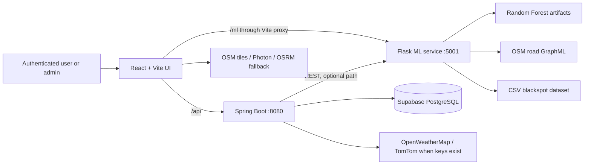
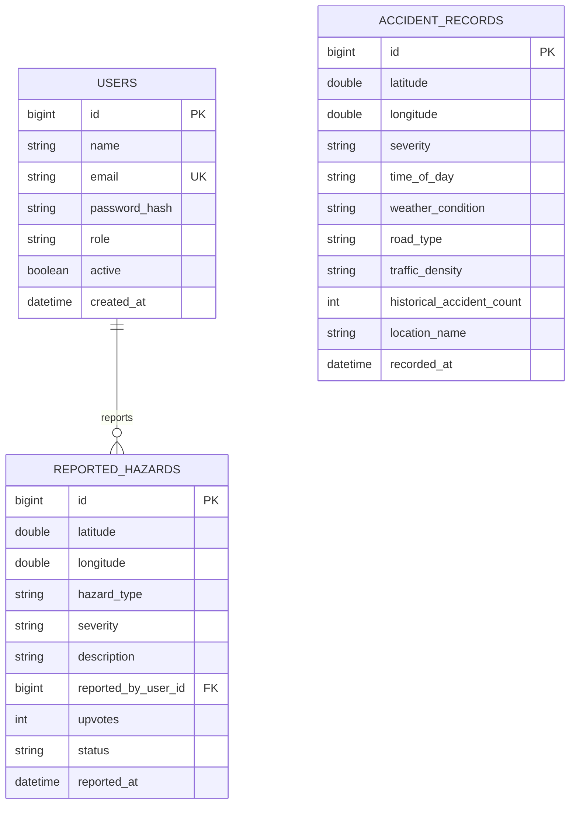

# SafeRoute AI — Complete Project Guide

> **Source of truth:** this guide was produced from the current repository on 16 October 2026. It describes code that is present now, not presentation text or visual labels. Status labels are **IMPLEMENTED**, **PARTIALLY IMPLEMENTED**, **PLANNED**, or **NOT VERIFIED**. Driving score and leaderboard functions are intentionally excluded.

## 1. Project Overview

**Title:** SafeRoute AI — AI-Powered Road Accident Risk Prediction and Safe Route Recommendation System.

SafeRoute AI is a Nagpur-focused web application that combines an accident-blackspot dataset, a machine-learning risk classifier, an OpenStreetMap road graph, and community hazard reports. A logged-in user can inspect blackspots, search origin and destination, compare a safety-weighted route against a shortest route, and report a local road hazard. Administrators can manage users, blackspots, and hazards.

### Problem, need, and proposed solution

Ordinary navigation usually optimizes distance or travel time. It does not necessarily explain accident history near a road or avoid riskier segments. SafeRoute’s proposed solution adds a road-risk layer: it classifies a selected location’s risk and computes an alternative route whose cost includes distance, road/blackspot risk, and optional traffic/weather inputs.

The current scope is Nagpur: the routing graph is downloaded around `(21.1458, 79.0882)` with an 8 km radius, and the ML dataset is named `nagpur_accident_dataset.csv`. Target users are drivers and an administrator managing local safety data. Useful real-world extensions include route planning for commuters, delivery fleets, and municipal hazard reporting.

**Advantages:** it shows historical blackspots, distinguishes a shortest route from a safety-weighted route, supports authenticated community reports, and provides an admin console. It does **not** guarantee safety or prevent accidents.

### 60–90 second presentation opening

“SafeRoute AI is a Nagpur road-safety navigation system. The problem is that a shortest route may pass through accident-prone roads, while existing navigation mainly focuses on time and distance. Our system combines a React map interface, a Spring Boot backend, a PostgreSQL database, and a Python machine-learning service. The ML service uses a Random Forest model trained on the available Nagpur blackspot records to estimate low, medium, or high risk. For routing, it uses an OpenStreetMap road graph and a safety-weighted A* algorithm. The algorithm compares the normal shortest path with a route that adds penalties for road risk, accident blackspots, weather, and congestion when such conditions are supplied. Users can view blackspots, calculate routes, and report hazards; administrators can manage users and safety records. The project is a decision-support system: it provides safer-route suggestions and transparent risk information, not a guarantee of accident-free travel.”

## 2. Complete Technology Stack

| Area | Technology actually present | Use and connection | Status |
|---|---|---|---|
| UI | React 18, React DOM, Vite 5 | `saferoute-ui/src/main.jsx` mounts `App.jsx`; Vite proxies `/api` to Spring and `/ml` to Flask. | **IMPLEMENTED** |
| UI libraries | React Leaflet/Leaflet, Lucide React, Recharts | Maps, icons, and blackspot analytics charts in `pages/`. | **IMPLEMENTED** |
| Backend | Java 17, Spring Boot 3.4.6 | REST API, security, JPA persistence, WebSocket broker. `pom.xml`, `src/main/java/`. | **IMPLEMENTED** |
| Persistence | Spring Data JPA/Hibernate; PostgreSQL driver | Entities/repositories connect to the configured Supabase PostgreSQL URL. | **IMPLEMENTED** |
| ML/routing | Python, Flask, scikit-learn, pandas, NumPy, joblib, NetworkX, OSMnx | `MlService/ml_service.py` loads model artifacts and road graph; Spring can proxy it. | **IMPLEMENTED** |
| Spatial data | OpenStreetMap tiles and GraphML; Photon geocoding | Leaflet displays tiles; OSMnx graph supports routing; Flask calls Photon for search. | **IMPLEMENTED** |
| Routing fallback | Public OSRM demo service | Browser falls back to OSRM if its direct `/ml/safe-route` call fails. It is a basic route, not risk-aware. | **IMPLEMENTED** |
| Weather/traffic | OpenWeatherMap and TomTom client code | Spring `/api/weather` and `/api/traffic` proxy services when keys are configured; otherwise return mock payloads. UI route request does not supply them. | **PARTIALLY IMPLEMENTED** |
| Security | Spring Security, JJWT, BCrypt | Stateless Bearer JWT authentication and server-enforced roles. | **IMPLEMENTED** |
| Realtime | Spring STOMP/WebSocket/SockJS server configuration | New hazard reports are broadcast to `/topic/hazards`; current React code does not subscribe. | **PARTIALLY IMPLEMENTED** |
| Build/deploy | Maven wrapper, npm, Dockerfile, Gunicorn dependency | Backend Dockerfile exists; frontend/ML deployment manifests are absent. | **PARTIALLY IMPLEMENTED** |

`mysql-connector-j` is declared in `pom.xml`, but the active `application.properties` config is PostgreSQL. No MySQL configuration is verified. Supabase is used as hosted PostgreSQL; no Supabase client SDK appears in the code.

## 3. System Architecture

**Important implementation detail:** the intended Spring-to-Flask bridge is `service/MlService.java`, and backend endpoints `/api/predict-risk` and `/api/safe-route` use it. However, `saferoute-ui/src/services/api.js` currently calls `/ml/predict-risk`, `/ml/safe-route`, `/ml/geocode`, and `/ml/blackspots` **directly through Vite**, not those Spring endpoints. Thus, in the current browser flow, Spring is used for authentication and hazards/admin data while Flask directly serves ML/routing/map analytics.

Responsibilities: React renders and gathers input; Spring owns accounts, roles, hazards and optional external proxies; PostgreSQL persists the Spring entities; Flask performs model inference, route calculation, geocoding proxying and CSV blackspot aggregation; OpenStreetMap supplies tile/road data.

## 4. Complete Application Workflow

1. **Open/login — IMPLEMENTED.** `App.jsx` shows `LoginPage` or `RegisterPage` until `AuthContext` has a stored user. Registration posts to Spring, then the UI logs in. Login stores a JWT in `localStorage` (`saferoute_token`, session object).
2. **Authorization — IMPLEMENTED.** Spring’s `JwtAuthFilter` validates a Bearer token. Normal registration always creates `ROLE_USER`; the guarded `/api/auth/init-admin` can create one admin only when `ADMIN_INIT_SECRET` is configured.
3. **Map/blackspots — IMPLEMENTED.** `MapPage.jsx` loads Flask `/blackspots` and Spring `GET /api/hazards`. It displays CSV-derived blackspots and active user hazards separately, supports map tiles, filters and browser geolocation.
4. **Destination selection and route — IMPLEMENTED.** `NavigatePage.jsx` uses Photon-backed Flask `/geocode` (and also contains a Nominatim helper) to select suggestions, then posts coordinates to Flask `/safe-route`. Flask snaps to the graph, runs both route variants, returns geometry/risk/distance, and React draws polylines. If unavailable, React uses OSRM.
5. **Risk prediction — IMPLEMENTED but not a prominent UI flow.** Flask `/predict-risk` accepts a selected coordinate plus time/weather/traffic/road category. Spring exposes an equivalent protected `/api/predict-risk`; the present UI API helper calls Flask directly. `RiskAnalysisPage` is dataset analytics, not an individual prediction form.
6. **Hazards — IMPLEMENTED.** Logged-in users submit a validated hazard through `ReportHazardModal`; Spring saves it, associates it with the user and broadcasts it. Navigation uses browser GPS plus local Haversine/polyline checks to warn about active hazards/CSV blackspots nearby.
7. **Administration — IMPLEMENTED server-side.** Admin JWTs can retrieve stats and CRUD users, accident records called blackspots, and hazards. `AdminPage.jsx` calls those endpoints.

There is no verified automated weather lookup before a route request; live conditions influence Flask routing only if included in the request payload.

## 5. Feature-by-Feature Explanation

| Feature | Internal implementation and verified files/endpoints | Status |
|---|---|---|
| Authentication | `AuthContext.jsx`, `LoginPage.jsx`, `RegisterPage.jsx`; Spring `AuthController`, `AuthService`; `POST /api/auth/register`, `/login`. BCrypt hash + JWT. | **IMPLEMENTED** |
| Roles/admin | `User.Role`, `SecurityConfig`, `AdminController`, `AdminPage.jsx`; `ROLE_ADMIN` protected server side. Note UI normalizes role to `admin`. | **IMPLEMENTED** |
| Interactive map | `MapPage.jsx`, React Leaflet, four selectable tile providers, markers/circles, GPS button and map click picker. | **IMPLEMENTED** |
| Location selection | Search suggestions in `NavigatePage.jsx`; Flask Photon `/geocode`; browser GPS. Map click is verified for reporting hazards, not for route origin/destination. | **IMPLEMENTED/PARTIAL** |
| Blackspots/risk indicators | Flask aggregates CSV location data via `/blackspots`; map markers and `RiskAnalysisPage` tables/charts. This is not a continuous heatmap. | **IMPLEMENTED** |
| Individual ML prediction | Flask `predict()` and Spring `PredictionController`; Random Forest classification. | **IMPLEMENTED** |
| Safe route | Flask `safe_route()`, `risk_router.compare_routes()`, `NavigatePage`; shows safe vs fast route. | **IMPLEMENTED** |
| Weather/time/road analysis | Time/weather/road/density are ML inputs. Routing has weather/congestion penalty support but UI does not collect/send live conditions. | **PARTIALLY IMPLEMENTED** |
| Hazard reporting | `ReportHazardModal.jsx`, `HazardController`, `HazardService`, `ReportedHazard`; reporting, active list, upvote endpoint, resolve endpoint. UI does not call upvote. | **IMPLEMENTED/PARTIAL** |
| Emergency alerts | Local proximity banners exist (`useProximityAlerts`, `useRouteBlackspotAlert`); no emergency-service integration/push notification verified. | **PARTIALLY IMPLEMENTED** |
| WebSocket live updates | Spring publishes `/topic/hazards`; no React STOMP client/subscription found. | **PARTIALLY IMPLEMENTED** |
| Responsive interface | CSS grid classes, mobile menus and map controls exist. No device-test record is stored. | **IMPLEMENTED; test not verified** |

## 6. Artificial Intelligence and Machine Learning

### Why ML is used

Accident risk depends on interacting variables, such as place, time, weather, road category and traffic density. A classifier can learn patterns from labelled records rather than relying on one fixed rule. It predicts a **risk class**, not whether an accident will definitely occur.

### Dataset and preprocessing

The canonical source is `MlService/nagpur_accident_dataset.csv`, with **20 rows** and 10 columns, verified from the file and `model_metadata.json`: `id`, `location`, `latitude`, `longitude`, `time_of_day`, `weather`, `road_type`, `traffic_density`, `accident_count`, `risk_level`. Dataset origin is **NOT VERIFIED** in repository documentation. `nagpur_accident_training_data.csv` is a cleaned generated copy; `.pre_dedup_backup` preserves a prior copy.

`ml_model.py` checks required columns, removes exact duplicates, rejects conflicting duplicate IDs, drops missing required/numeric values, converts numeric columns, and validates latitude/longitude ranges. It label-encodes weather, road type, traffic density and target risk. It derives `is_night`, `is_peak`, and `is_bad_weather`. It uses a 75/25 stratified train/test split with `random_state=42`. `class_weight="balanced"` addresses class imbalance. No scaling, one-hot encoding, feature-importance report, cross-validation, or external validation is implemented.

### Actual model inputs

The exact ordered feature list is:

`latitude`, `longitude`, `time_of_day` (hour), `weather_enc`, `road_enc`, `density_enc`, `accident_count`, `is_night`, `is_peak`, `is_bad_weather`.

The inference endpoint maps UI labels to trained categories. It defaults missing accident count to 5 and missing weather/density/road values to Clear/Low/City Road; these defaults are important limitations. The model does not directly use month, weekday, season, road lighting, junction boolean, GPS traffic stream, or user hazards as classifier inputs.

### Algorithm, training, and output

`RandomForestClassifier` uses 100 decision trees, `max_depth=10`, `min_samples_split=5`, `min_samples_leaf=2`, balanced class weights and a fixed seed. A decision tree splits feature values into class-predictive groups; a Random Forest combines many trees to reduce one-tree instability. This is **classification** because the output is one category (`HIGH`, `MEDIUM`, `LOW`), unlike regression, which returns a continuous numeric target.

`ml_model.py` saves `model.pkl` and four `LabelEncoder` files with joblib. `ml_service.py:load_model()` loads them. `predict()` builds a one-row DataFrame in the training feature order, calls `predict_proba`, selects the highest-probability label, and returns `riskLevel`, `confidence`, a message and debug fields.

### Evaluation and limitations

`model_metadata.json` records `accuracy: 1.0`, based on the script’s **5-record test split** (20 records × 25%). This is an exploratory held-out accuracy, not proof of real-world accuracy; the script itself warns the dataset is too small for production-grade evaluation. No saved precision, recall, F1, confusion matrix, date, or repeat-run report was found.

The sample is tiny and may not represent all Nagpur roads, seasons, traffic states, or accident-reporting bias. Static labels, default inference values and changing road conditions create uncertainty. Present it as a prototype decision-support model, never a safety guarantee.

## 7. Safe Route Recommendation Algorithm

**IMPLEMENTED:** `MlService/risk_router.py` uses NetworkX A* over an OpenStreetMap `MultiDiGraph`. Nodes are intersections/road-network points; directed edges are drivable segments. `download_nagpur_graph.py` obtains an 8 km driving graph around central Nagpur and saves `data/nagpur_road_network.graphml`.

For each edge, `load_graph()` calculates static `risk_score` from highway class (20%), max speed (20%), lighting (15%), surface (15%), junction (10%), and nearby CSV blackspot score (20%). Blackspots use a 250 m radius and their risk/accident count. A SciPy `cKDTree` is attempted for spatial lookup; SciPy is not explicitly listed in `requirements.txt`, so the code falls back to scanning records if unavailable.

A* uses `f(n)=g(n)+h(n)`: `g(n)` is accumulated route cost and `h(n)` is Haversine straight-line distance to the destination. For a candidate edge, the actual dynamic cost is:

`length_m × (1 + 1.5 × congestion) + dynamic_risk × 500`

where `dynamic_risk = min(1, static_risk + 0.25 × weather_risk + 0.20 × congestion)`. The safe route uses penalty 500; the fast/short route uses penalty 0. Both still include congestion in distance cost if conditions are passed. `compare_routes()` returns distance, average risk, risk reduction and recommendation.

Illustrative example (not a repository result): a 1,000 m route at 0.8 risk costs `1000 + 0.8×500 = 1400`; a 1,150 m route at 0.2 risk costs `1150 + 0.2×500 = 1250`. The longer route wins the safety-weighted comparison. The shortest path ignores the 500-point risk penalty; the lowest-risk path would optimize risk alone; SafeRoute balances length and risk.

## 8. Database Design

The active configuration is Supabase-hosted PostgreSQL via JDBC; database name is `postgres` in the URL. Hibernate uses `ddl-auto=update`, so exact deployed constraints beyond the entity mappings are **NOT VERIFIED**.

`User` has a lazy one-to-many relationship with `ReportedHazard`; a hazard has a lazy many-to-one `reportedBy` relationship through `reported_by_user_id`. `AccidentRecord` is independent; admin code treats it as a manageable blackspot record. IDs are identity-generated. Non-null/unique fields are exactly those shown in entity annotations; hazard `status` does not have `nullable=false` annotated even though a builder default is provided.

Repositories: `UserRepository` finds/checks email and role; `HazardRepository` queries status, reporter, bounding box and counts; `AccidentRecordRepository` offers bounding-box/high-severity queries and native aggregation for top locations. Passwords and secrets are not documented here and must not be committed.

## 9. Backend Implementation and Verified APIs

Spring is organized as Controller → Service → Repository → Entity. For example, `HazardController` accepts HTTP input, `HazardService` attaches the logged-in user/saves/broadcasts, and `HazardRepository` executes persistence. DTOs such as `HazardRequest` prevent the entity itself becoming the public API model.

| Method | Endpoint | Purpose / request | Auth |
|---|---|---|---|
| POST | `/api/auth/register` | name, email, password; creates user | Public |
| POST | `/api/auth/login` | email/password; returns token/user | Public |
| POST | `/api/auth/init-admin` | name/email/password/secret; first admin only | Public endpoint, server secret required |
| GET | `/api/hazards` | active reported hazards | Public |
| POST | `/api/hazards` | validated lat/lon/type/severity/description | JWT |
| PUT | `/api/hazards/{id}/upvote` | increments upvote count | JWT |
| PUT | `/api/hazards/{id}/resolve` | resolves a hazard | Admin |
| POST | `/api/predict-risk` | `RiskRequest`; Spring→Flask bridge | JWT |
| POST | `/api/safe-route` | origin/destination coordinates; Spring→Flask bridge | JWT |
| GET | `/api/weather?lat=&lon=` | OpenWeatherMap proxy/mock | Public |
| GET | `/api/traffic?lat=&lon=` | TomTom proxy/mock | Public |
| GET | `/api/admin/stats` | counts/severity/top blackspots | Admin |
| GET/POST | `/api/admin/users` | GET lists users; POST is not mapped | Admin |
| PUT/DELETE | `/api/admin/users/{id}/activate`, `/deactivate`, `/{id}` | user management | Admin |
| GET/POST | `/api/admin/blackspots` | list/create accident records | Admin |
| GET | `/api/admin/blackspots/area` | `minLat,maxLat,minLon,maxLon` | Admin |
| PUT/DELETE | `/api/admin/blackspots/{id}` | edit/delete record | Admin |
| GET/POST | `/api/admin/hazards` | list/create hazard | Admin |
| PUT/DELETE | `/api/admin/hazards/{id}` | edit/delete hazard | Admin |
| PUT | `/api/admin/hazards/{id}/resolve` | resolve hazard | Admin |

Flask APIs: `GET /health`, `POST /predict-risk`, `POST /safe-route`, `GET /geocode?q=&limit=`, and `GET /blackspots?risk=`. These have no JWT validation themselves; Vite development proxy exposes them at `/ml/*`. This is a significant deployment/security consideration.

## 10. Frontend Implementation

`main.jsx` mounts `App.jsx`. It uses local component state instead of React Router: `AppInner` switches among `MapPage`, `NavigatePage`, `RiskAnalysisPage`, and `AdminPage`. `MainLayout` renders navigation and a hazard-report entry point. `AuthContext` keeps the JWT/session in browser local storage and attaches the token through `services/api.js`.

Key screens: `MapPage.jsx` renders dataset blackspots/user reports and a map picker; `NavigatePage.jsx` searches locations, maps both routes and watches GPS; `RiskAnalysisPage.jsx` fetches blackspots and renders Recharts plus a client-side CSV export; `AdminPage.jsx` manages backend entities. API errors become UI messages; route requests reject implausible graph snaps and use OSRM fallback. Leaflet markers/polyline map output comes from Flask `Coordinate` objects (`lat`, `lon`) or OSRM GeoJSON coordinates.

## 11. APIs and External Services

- **OpenStreetMap tiles:** visual base maps in `MapPage`/`NavigatePage`; a tile provider is not a routing engine.
- **OSMnx/GraphML:** downloads and loads drivable OSM network for Flask A* routing.
- **Photon (Komoot):** Flask geocoding proxy calls `https://photon.komoot.io/api/`, filters results near Nagpur and caches in memory.
- **OSRM public demo:** browser fallback supplies basic road route geometry; it does not receive SafeRoute risk weights.
- **OpenWeatherMap / TomTom:** Spring server-side proxies call them only with configured key values; otherwise they return explicitly marked mock objects.
- **Supabase PostgreSQL:** JDBC database host. It is database hosting, not a frontend Supabase API integration.

## 12. Security

Implemented measures are BCrypt password hashing, JWT HS256 tokens with configurable expiration (86,400,000 ms), stateless Spring Security, role checks, DTO validation, global JSON error handling, localhost-only CORS origins, environment/property placeholders, and server-side admin routes. Tests verify user tokens cannot access admin stats/resolve and unauthenticated users cannot report hazards.

Gaps: Flask direct endpoints are not authenticated; JWT is stored in localStorage (XSS exposure); CORS is development-oriented; no rate limiting, refresh/revocation flow, email verification, audit log, CSRF protection for cookie use, HTTPS/reverse-proxy config, or frontend WebSocket subscription is verified. `ddl-auto=update` is convenient for development but requires caution in production. Never expose `DB_PASSWORD`, `APP_JWT_SECRET`, API keys, or `ADMIN_INIT_SECRET`.

## 13. Deployment and Configuration

Required names only: `DB_PASSWORD`, `APP_JWT_SECRET`, `ML_SERVICE_URL` (defaults to `http://localhost:5001` in properties), `WEATHER_API_KEY`, `TRAFFIC_API_KEY`, `ADMIN_INIT_SECRET`, and optionally `ML_SERVICE_PORT` (Flask defaults to 5001). Spring listens on 8080, Vite on 5173.

Local sequence:

1. Configure the PostgreSQL/JWT environment values; start PostgreSQL/Supabase connection access.
2. In `MlService`, create a Python 3.9–3.12 environment, install `requirements.txt`, run `python ml_model.py` if artifacts need regeneration, ensure `data/nagpur_road_network.graphml` exists (or run `python download_nagpur_graph.py`), then `python ml_service.py`.
3. At repository root run `mvnw.cmd spring-boot:run`.
4. In `saferoute-ui`, run `npm install` then `npm run dev`.

`Dockerfile` builds/runs only Spring backend. It needs supplied environment variables and reachable database/ML service. No Compose/Kubernetes/frontend deployment configuration is present. Common failures: missing secrets/database access prevent Spring start; missing model artifacts produce Flask 503 prediction; graph loading/missing GraphML produces route 503; unavailable Photon/OSRM affects search/fallback; browser GPS needs permission and HTTPS or localhost.

## 14. Testing and Results

Verified automated-test source exists:

| Test area | Evidence | Actual status |
|---|---|---|
| Spring context | `ProjectApplicationTests.contextLoads` | Test present |
| Authorization | `SecurityAuthorizationIntegrationTests` checks admin denial/access | Test present |
| Hazard validation/persistence | Same test class checks JWT, coordinates and 501-character rejection | Test present |
| Router live conditions | `MlService/test_risk_router.py` checks normalization and increased risk in rain/congestion | Test present |
| ML evaluation | Metadata says 1.0 exploratory test accuracy on 5 hold-out records | Recorded, limited |
| UI map/responsiveness/end-to-end | No browser test suite or result report found | **NOT VERIFIED** |

Proposed manual demo tests: register/login, report a hazard, refresh the map, calculate a route inside graph coverage, turn browser location on, and log in as admin to confirm management actions. Do not call these completed unless executed in the target environment. No repository screenshots were found.

## 15. Advantages and Limitations

Compared with a basic shortest-route app, SafeRoute can show recorded blackspots and explain a distance-versus-risk comparison. Its limitations are small historical data, GraphML coverage, static/optional conditions, public external-service dependence, browser GPS accuracy, unverified production scale, no Flask auth, and the fact that a route score cannot account for every real-time hazard or driver behavior.

## 16. Future Scope

Use a larger dated, verified accident dataset; add external validation/cross-validation and calibrated probabilities; ingest live weather/traffic into the actual UI route request; include authenticated Flask access via Spring gateway; subscribe React to hazard WebSockets; add report moderation/deduplicated upvotes; expand graph coverage; provide route explanations per risky segment; add robust mobile/browser testing; and integrate official emergency information only through verified providers. These are future ideas, not current capabilities.

## 17. 5–7 Minute Presentation Script

“Good morning. Our project is SafeRoute AI, an AI-powered road accident risk prediction and safe route recommendation system for Nagpur.

The problem is that normal navigation generally gives the shortest or fastest route. That route can still pass through locations with a higher accident history. Our goal is to help users make a more safety-aware choice.

The frontend is React with Leaflet for maps and Recharts for analysis. The backend is Spring Boot, which manages users, JWT login, roles, hazards, and the PostgreSQL database. A separate Flask service loads the machine-learning model and the Nagpur road network. React currently communicates directly with Flask through the Vite development proxy for routing and analytics, and with Spring Boot for secured application data.

For prediction, we use a Random Forest classifier. It uses coordinates, hour, encoded weather, road type, traffic density, accident count, and three derived indicators: night, peak time, and bad weather. The available dataset has only 20 independent records, so we present the saved 100 percent hold-out accuracy as exploratory only, not as a production claim.

For safe routing, we model roads as a graph: intersections are nodes and road segments are edges. A-star search finds routes using distance plus risk. The safe cost adds a penalty for road characteristics and nearby blackspots, with optional traffic congestion and weather effects. We compare this route with a route using zero risk penalty, which is the shortest-path comparison.

Users can register, log in, inspect blackspots, search locations, compare routes, and report a hazard. An administrator can manage users, blackspots, and hazards. The system stores users, accident records, and reported hazards in PostgreSQL.

The important limitation is that our output is a decision-support recommendation, not a promise that a road is safe. Data coverage, current conditions, and reporting quality affect the result. In future, we would use larger verified data, real-time integrations, stronger validation, and live WebSocket updates. Thank you.”

## 18. Live Demonstration Script

1. Start on Login. Say: “Access is authenticated; new registrations become normal users.” Register a fresh account if database access is available.
2. Open **Map**. Say: “Red/orange/green markers come from the Flask CSV blackspot aggregation; yellow hazard markers are user reports from PostgreSQL.” Toggle/filter markers and optionally switch tile layer.
3. Click **Report Hazard**. Search/select or use map picker, choose a valid type/severity, submit. Say: “Spring validates this request, associates it with the authenticated user, saves it, and broadcasts a WebSocket event.” Refresh if no live client update occurs.
4. Open **Navigate**. Choose suggestion entries rather than only typing text; click Find Safe Route. Explain the green safe and orange fast route and compare distance/risk values. Use origin/destination near central Nagpur to improve GraphML coverage.
5. If ML route fails, say: “The graph/service is unavailable or outside coverage, so the UI uses OSRM only as a basic fallback. It is not a safety-weighted route.”
6. Open **Risk Analysis**. Explain that charts aggregate the supplied blackspot CSV and export is a client-side CSV export.
7. Only if an admin account has been initialized, demonstrate **Admin** user/blackspot/hazard management. If unavailable, say that it is server-protected and needs the deployment’s administrator initialization secret.

## 19. Viva Questions and Answers

1. **What is the main aim?** Recommend routes that balance distance with road-risk information.
2. **Why not use only shortest path?** Shortest distance can traverse accident-prone segments.
3. **What is the frontend?** React 18 built with Vite.
4. **What renders the map?** React Leaflet and Leaflet.
5. **Does Leaflet calculate routes?** No; it renders maps and geometry.
6. **What is the backend?** Java Spring Boot.
7. **Why use Spring Boot?** It provides REST APIs, security, validation and JPA persistence.
8. **What is REST?** An HTTP-based way for client and server to exchange resources.
9. **What database is configured?** PostgreSQL hosted through Supabase.
10. **What is JPA?** Java Persistence API, an abstraction mapping Java entities to database tables.
11. **What is Hibernate?** The JPA implementation used by Spring Boot here.
12. **What entities exist?** User, ReportedHazard and AccidentRecord.
13. **How are passwords protected?** BCrypt hashing, not plain text.
14. **What is JWT?** A signed token carried in the Authorization Bearer header.
15. **How are roles enforced?** Spring Security rules and `@PreAuthorize` on server endpoints.
16. **Can a normal user access admin APIs?** No; integration tests check this.
17. **What is Flask used for?** ML inference, routing, geocoding and CSV blackspots.
18. **What ML algorithm is used?** Random Forest classifier.
19. **Classification vs regression?** Classification returns classes; regression predicts a continuous value.
20. **What are its output classes?** High, Medium and Low risk.
21. **Name model inputs.** Coordinates, hour, weather, road type, traffic density, accident count and derived flags.
22. **Why encode categories?** The model needs numeric feature values.
23. **What is the split?** Stratified 75% training, 25% testing with seed 42.
24. **Why is 100% accuracy not enough?** It is based on only five held-out records.
25. **How is imbalance addressed?** `class_weight="balanced"`.
26. **What is A*?** A graph search combining known cost and estimated remaining cost.
27. **What are g, h and f?** Travel cost, heuristic estimate, and their sum.
28. **Which heuristic is used?** Haversine straight-line distance to destination.
29. **What is a graph node/edge here?** A road-network point/road segment.
30. **How does risk change cost?** Dynamic risk is multiplied by 500 and added to distance cost.
31. **What static factors build edge risk?** Road class, speed, lighting, surface, junction and blackspot proximity.
32. **How are blackspots used?** Dataset points within 250 m raise nearby edge risk.
33. **What if ML service is down?** The frontend tries OSRM fallback for a basic route.
34. **Is OSRM fallback safety-aware?** No.
35. **What is OpenStreetMap’s role?** Tile display and source road graph data.
36. **What is Photon’s role?** Geocoding typed locations to coordinates.
37. **How are hazards reported?** Authenticated POST to Spring then PostgreSQL persistence.
38. **Is WebSocket live update complete in UI?** Server broadcasts, but React subscription is not implemented.
39. **How are weather/traffic handled?** Spring supports optional proxies/mocks; route UI currently does not send them.
40. **What is a major security gap?** Direct Flask APIs lack JWT protection.
41. **What is a major data limitation?** Only 20 independent training records.
42. **Does prediction guarantee safety?** No; it is a risk estimate from limited data.

## 20. Fifteen Questions to Prepare First

| Question | Best short answer | Extra point |
|---|---|---|
| What problem do you solve? | Shortest navigation may ignore accident risk. | We compare shortest and safety-weighted paths. |
| Why Random Forest? | It handles mixed, non-linear safety factors and returns class probabilities. | It uses 100 trees here. |
| What is the real dataset size? | 20 independent rows in the canonical CSV. | Therefore evaluation is exploratory. |
| What are model inputs? | Location, hour, encoded conditions, accident count, and derived flags. | Missing inference values have defaults. |
| What does 100% accuracy mean? | One saved five-record test split result. | It is not real-world validation. |
| Explain A*. | It searches using cost so far plus estimated distance remaining. | Haversine is the heuristic. |
| What is the safe cost? | Length with congestion plus dynamic risk times 500. | Weather/congestion are optional request inputs. |
| What is the difference from OSRM? | Flask A* uses SafeRoute weights; fallback OSRM does not. | OSRM is used only after failure. |
| Explain architecture. | React UI, Spring secured data API, Flask ML/routing, PostgreSQL. | UI currently directly calls Flask via proxy. |
| How is login secured? | BCrypt password verification and JWT Bearer token. | Roles are checked on the server. |
| What tables exist? | users, reported_hazards, accident_records. | Hazards link to reporting user. |
| Is weather live? | Proxy code exists, but current route UI does not send it. | Missing keys return marked mock payloads. |
| How do hazards update? | Spring saves and broadcasts to `/topic/hazards`. | React subscription is still missing. |
| What are key limitations? | Tiny dataset, static graph/data, dependency on APIs/GPS. | No result guarantees safety. |
| What would you improve? | Larger verified data and real-time integrated conditions. | Add Flask authentication and model validation. |

## 21. Quick Revision Sheet

**Objective:** help Nagpur users choose routes informed by accident-risk data, not only distance. **Problem:** a shortest route may cross roads with higher historical accident risk.

**Stack:** React/Vite + Leaflet/Recharts; Spring Boot/Java/JPA/Security/JWT; Supabase PostgreSQL; Flask/Python/scikit-learn/NetworkX/OSMnx; OSM, Photon and OSRM fallback.

**Flow:** User → React → Spring for auth/hazards/admin → PostgreSQL; React → Flask via `/ml` proxy for prediction, geocode, blackspots and A* routing → React map.

**Main features:** JWT login, role-based admin, blackspot map/analytics, risk classifier API, safe-vs-fast route comparison, hazard reporting, GPS proximity warnings.

**ML:** Random Forest classifier; ten inputs: latitude, longitude, hour, encoded weather/road/density, accident count, night/peak/bad-weather flags. Dataset: 20 rows. Saved exploratory accuracy: 1.0 on 5 test rows only.

**Routing:** NetworkX A* on OSM GraphML. Cost = `length × (1 + 1.5 congestion) + dynamicRisk × 500`; shortest comparison uses zero risk penalty.

**Database:** `users`, `reported_hazards`, `accident_records`; hazards reference users.

**Main APIs:** Spring `/api/auth/*`, `/api/hazards`, `/api/admin/*`; Flask `/health`, `/predict-risk`, `/safe-route`, `/geocode`, `/blackspots`.

**Remember:** (1) the model is limited-data prototype, (2) Flask direct calls bypass Spring in current UI, (3) OSRM fallback is not AI-safe routing, (4) weather/traffic integration is only partial, (5) never promise an accident-free route.
